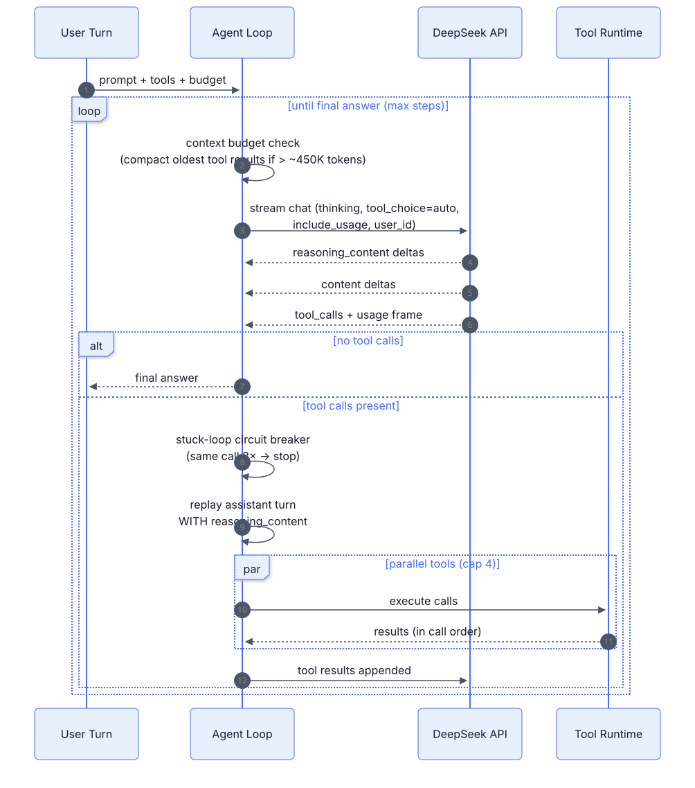

<div align="center">

# 🦞 OpenClaw DeepSeek Plugin

**A world-class DeepSeek integration for [OpenClaw](https://docs.openclaw.ai)**

[]()
[]()
[]()
[]()

*Native agent harness · Universal speculative cascade · Live cost observability · Economic self-governance*

**English** | [简体中文](README.zh-CN.md)

</div>

---

## ✨ Why this plugin

OpenClaw ships a solid transport-level DeepSeek provider. This plugin goes **deeper** — it runs DeepSeek's own function-calling loop natively, orchestrates speculative cascades across **any** gateway provider, and watches every dollar you spend.

<p align="center">
  
</p>

> **Named `openclaw-deepseek`** — deliberately *not* "DeepSeek Harness", which is DeepSeek's own flagship open-source agent project ([github.com/deepseek-ai/deepseek-harness](https://github.com/deepseek-ai/deepseek-harness)).

---

## 🧠 Native Agent Harness

Route any turn through DeepSeek's **own** tool-orchestration loop — with thinking control, vision, and the `reasoning_content` replay contract done right.

<p align="center">
  
</p>

**Hard-won correctness details:**

| Mechanism | What it prevents |
| --- | --- |
| `reasoning_content` full-chain replay | DeepSeek **400** on tool turns — the #1 community pitfall |
| `tool_choice` forced to `auto` under thinking | 400 on required/named tool choice |
| Sampling params stripped while thinking | Silently-ignored `temperature` / `top_p` |
| Self-healing context compaction | Whole-run failure on context overflow |
| Stuck-loop circuit breaker (with decay) | Infinite identical tool calls |
| 429 / `insufficient_system_resource` backoff (1s/3s/9s) | Transient rate limits (non-streaming only) |
| `: keep-alive` SSE tolerance + `include_usage` frames | Broken streams behind proxies |
| Retired aliases (`deepseek-chat`, `deepseek-reasoner`, …) | Stale model names route to `deepseek-flash` + warning |

---

## ⚡ Universal Speculative Cascade

The signature feature. **Cheap model drafts → a judge grades → hard tasks escalate** through stronger tiers. Tiers and judge can be *any* configured gateway provider.

<p align="center">
  
</p>

**Any provider, any tier:**

```
Use deepseek_cascade with:
  task:  "derive the closed-form solution"
  tiers: ["deepseek-flash", "zai/glm-5.3", "anthropic/claude-sonnet-4-6"]
  judge: "zai/glm-5.3"
```

DeepSeek tiers run through the **native executor** (thinking control + cache-aware metering); everything else routes through the host LLM runtime — usage and cost merge into one trace. Most requests finish at tier-1 prices; hard ones get flagship quality.

> Cross-provider tiers require `plugins.entries.openclaw-deepseek.llm.allowModelOverride: true` in gateway config (operator opt-in). Pure-DeepSeek cascades need nothing extra.

### 🎯 The policy is a branch predictor

Like a CPU branch predictor, cheap history shapes expensive future routes. Task prompts are bucketed (`code / reasoning / factual / creative / general` × `short / medium / long`), tier-0 acceptance is tracked per bucket, and routes adapt — stats decay after 14 days and persist across restarts.

### 💰 The guardian is an economic state machine

<p align="center">
  
</p>

Every transition is written to the **decision audit trail** (persisted, filterable, human-readable).

---

## 📊 Live Cross-Provider Cost Dashboard

Every model call in the gateway — **any provider** — flows through the `llm_output` hook into a bounded, persistent ledger.

<p align="center">
  
</p>

**Honesty by design:** unknown models are never silently undercounted — they're tracked in tokens and reported as *unpriced*.

---

## 📦 Install & Configure

```bash
openclaw plugins install clawhub:autoclaw/openclaw-plugin-deepseek
# or from a local checkout:
openclaw plugins install ./openclaw-plugin-deepseek
```

Requires **OpenClaw ≥ 2026.9.1**, **Node ≥ 22.22.3**.

One key powers everything (reuses the built-in `deepseek` auth via `providerAuthAliases`):

```bash
export DEEPSEEK_API_KEY=sk-...   # gateway env, ~/.openclaw/.env, or auth store
```

Optional plugin config:

```json5
{
  plugins: {
    entries: {
      "openclaw-deepseek": {
        config: {
          baseUrl: "https://api.deepseek.com",   // bare domain per current docs; /v1 also works
          model: "deepseek-flash",               // V4.1-Flash (vision); or "deepseek-v4-pro"
          defaultReasoningEffort: "high",        // none | low | high | max
          researchMaxSteps: 8,
          researchMaxTokensPerStep: 16384,
          requestTimeoutMs: 180000
        }
      }
    }
  }
}
```

---

## 🗂️ Model Catalog *(2026-10, official)*

| Model ref | Context | Max output | Vision | Off-peak $/M (in / cache-hit / out) |
| --- | --- | --- | --- | --- |
| `openclaw-deepseek/deepseek-flash` | 1M | 384K | ✅ | 0.15 / 0.003 / 0.6 |
| `openclaw-deepseek/deepseek-v4-pro` | 1M | 384K | ❌ | 0.66 / 0.022 / 1.98 |
| `openclaw-deepseek/deepseek-cascade` | 1M | 384K | ❌ | flash-tier pricing; pro only on escalation |
| `openclaw-deepseek-anthropic/claude-*` | 1M | 384K | ❌ | Claude protocol; opus→v4-pro, sonnet/haiku→flash |

Retired names (`deepseek-chat`, `deepseek-reasoner`, `deepseek-v4-flash`, `deepseek-v4-flash-vision-exp`) still resolve — they route to `deepseek-flash` with a one-time migration warning.

The harness only claims `openclaw-deepseek/*` refs — your `deepseek/*` refs keep using the built-in provider. **Opt in per session or per agent.**

---

## 🚀 Use

```bash
/model openclaw-deepseek/deepseek-flash      # native harness, V4.1-Flash
/model openclaw-deepseek/deepseek-v4-pro     # native harness, flagship
/model openclaw-deepseek/deepseek-cascade    # speculative cascade
```

Thinking control follows OpenClaw's `/think` directive: `/think off` → `thinking: disabled`, `/think medium` → `reasoning_effort: high`, `/think max` → `reasoning_effort: max`.

### 🛠️ Agent tools *(available to every agent once enabled)*

| Tool | What it does |
| --- | --- |
| `deepseek_research` | Research loop: plans queries, calls host `web_search`, iterates, synthesizes a sourced answer. Budget-controlled (`max_searches`). |
| `deepseek_reason` | Cross-model second opinion: question + draft → verdict, specific flaws, improved answer. |
| `deepseek_balance` | DeepSeek account balance endpoint. |
| `deepseek_cascade` | Universal speculative cascade: 1–4 tiers of any gateway refs, judge verdict, per-call trace, cross-provider cost report. |
| `deepseek_extract` | Structured JSON extraction with schema validation + one automatic repair retry. |
| `deepseek_fim` | Fill-in-the-middle code completion (prefix + suffix → middle) via the beta FIM endpoint. |
| `deepseek_cost_report` | **Live cost dashboard** — `live` / `pricing` / `estimate` / `credits` views. |
| `deepseek_genesis` | Self-calibrate the adaptive cascade policy; reports the learned routing table. |

> *Example: "Use deepseek_research to compare DeepSeek V4.1-Flash vs V4-Pro pricing, then have deepseek_reason review your conclusion."*

---

## 🏗️ Architecture

<p align="center">
  
</p>

**Design principles:**

- 🚪 **Fail-closed auth** — no key → explicit errors, never hangs
- 🔌 **No core patches** — pure plugin SDK: `registerProvider`, `registerAgentHarness`, `registerTool`
- 👁️ **Observation-only hooks** — a ledger failure can never disturb an agent turn
- ⏱️ **Every timer `.unref()`-aware** — nothing pins the gateway process open
- 🧪 **Runtime boundary validation** — wire data is parsed and verified, never `as`-cast
- 💾 **Atomic persistence** — debounced writes, `tmp` + `rename`, corrupt snapshots start fresh
- 🚦 **AIMD concurrency control** — TCP-style adaptive windows per model, circuit-break on repeated 429s
- 💰 **Deterministic response cache** — identical repeat calls are free (LRU + TTL)

---

## 📈 Capability Matrix vs. built-in provider

<details>
<summary><b>Expand the full comparison (30+ capabilities)</b></summary>

| Capability | Built-in | This plugin |
| --- | --- | --- |
| Native agent loop (DeepSeek-side tool orchestration) | — | ✅ harness with step budgets |
| `reasoning_content` full-chain replay on tool turns | ✅ transport | ✅ native loop, verified by test |
| Thinking control (`none/low/high/max`) | partial | ✅ incl. `/think` level mapping |
| `tool_choice` required/named → auto downgrade under thinking | — | ✅ |
| Sampling-param stripping while thinking | — | ✅ |
| Retired model aliases | — | ✅ normalize + migrate warning |
| Vision input (V4.1-Flash) | — | ✅ images bridged as `image_url` |
| 429 / `insufficient_system_resource` retry with backoff | — | ✅ |
| SSE keep-alive tolerance + `include_usage` frames | — | ✅ |
| Speculative cascade | — | ✅ `deepseek-cascade` model + tool |
| Structured extraction (JSON mode + repair) | — | ✅ `deepseek_extract` |
| FIM code completion (beta endpoint) | — | ✅ `deepseek_fim` |
| Live cost dashboard (all providers) | — | ✅ `llm_output` hook + ledger |
| Universal pricing (LiteLLM catalog) | — | ✅ TTL-cached, offline-safe |
| Credits/balance panel | — | ✅ `view: credits` |
| Autonomous budget governance | — | ✅ green/amber/red guardian |
| Decision audit trail | — | ✅ persisted, filterable |
| Per-session KV-cache affinity (`user_id`) | — | ✅ |
| Claude-protocol transport (`/anthropic`) | — | ✅ |
| Harness multi-turn memory | — | ✅ transcript rebuild |
| Burn-rate forecast (EOD + red-crossing time) | — | ✅ |
| AIMD concurrency control | — | ✅ per-model adaptive windows |
| Deterministic response cache | — | ✅ repeat calls free |
| Peak/off-peak + cache-aware metering | — | ✅ `deepseek_cost_report` |
| Parallel tool execution (bounded, sequential-safe) | — | ✅ |
| Research / reason / balance tools | — | ✅ |

</details>

---

## 🔧 Develop

```bash
npm install
npm run build            # tsc strict
npm test                 # vitest: 102 tests
npm run plugin:validate  # structural validation without a gateway
```

Publish:

```bash
clawhub package publish autoclaw/openclaw-plugin-deepseek --dry-run
clawhub package publish autoclaw/openclaw-plugin-deepseek
```

**v1.x highlights** — true incremental streaming to channels · persistent ledger across restarts · `npm pack` clean (19 files, 35 kB) · CI runs build/test/validate/pack on every push. See [CHANGELOG.md](CHANGELOG.md).

---

## 📄 License

MIT — see [LICENSE](LICENSE)
