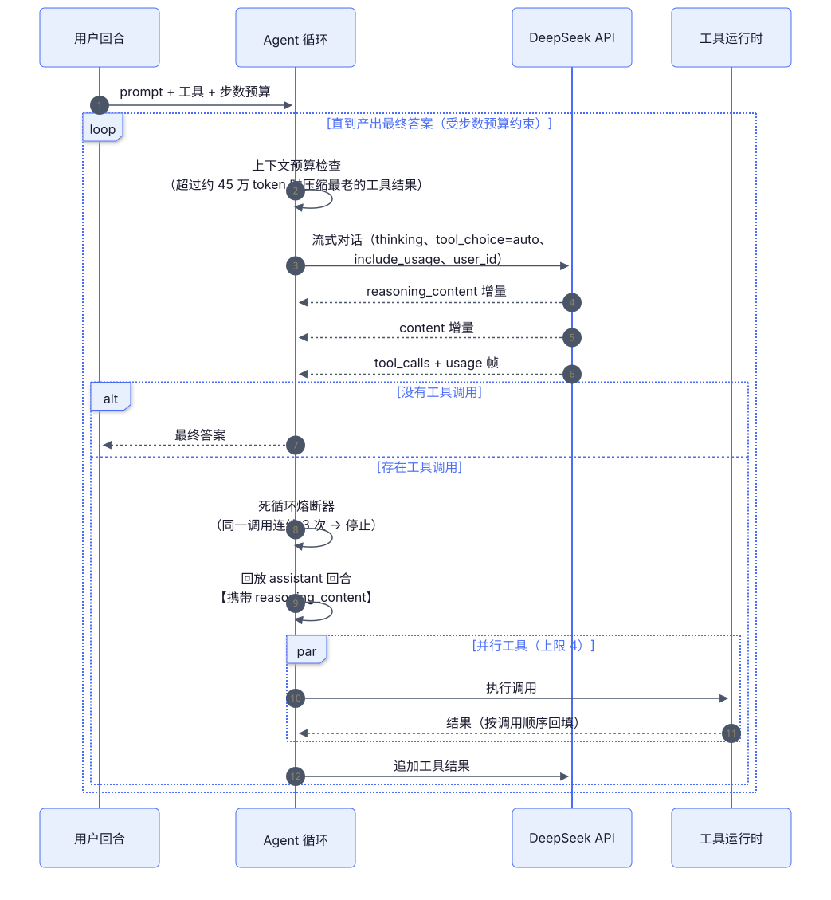

<div align="center">

# 🦞 OpenClaw DeepSeek 插件

**为 [OpenClaw](https://docs.openclaw.ai) 打造的世界级 DeepSeek 深度集成**

[]()
[]()
[]()
[]()

*原生 Agent 运行时 · 通用投机级联 · 实时成本可观测 · 经济自治*

[English](README.md) | **简体中文**

</div>

---

## ✨ 为什么需要这个插件

OpenClaw 内置的 DeepSeek provider 是一个可靠的传输层实现。本插件走得更**深**——它在 DeepSeek 侧原生执行函数调用循环，跨**任意**网关 Provider 编排投机级联，并盯住你花出去的每一分钱。

<p align="center">
  
</p>

> **命名为 `openclaw-deepseek`**——刻意不叫 "DeepSeek Harness"，那是 DeepSeek 官方的旗舰开源 agent 项目（[github.com/deepseek-ai/deepseek-harness](https://github.com/deepseek-ai/deepseek-harness)）。

---

## 🧠 原生 Agent Harness

把任意回合交给 DeepSeek **自己的**工具编排循环——思考控制、视觉输入，以及正确实现的 `reasoning_content` 回放契约。

<p align="center">
  
</p>

**血泪换来的正确性细节：**

| 机制 | 防住的问题 |
| --- | --- |
| `reasoning_content` 全链回放 | 工具回合触发 DeepSeek **400**——社区第一坑 |
| thinking 下 `tool_choice` 强制为 `auto` | required/named 工具选择导致的 400 |
| thinking 期间剥离采样参数 | 被静默忽略的 `temperature` / `top_p` |
| 自愈式上下文压缩 | 上下文溢出导致整轮失败 |
| 死循环熔断器（带衰减） | 无限重复的相同工具调用 |
| 429 / `insufficient_system_resource` 退避（1s/3s/9s） | 瞬时限流（仅非流式请求） |
| `: keep-alive` SSE 容忍 + `include_usage` 帧 | 代理后断流 |
| 退役别名（`deepseek-chat`、`deepseek-reasoner`……） | 旧模型名自动路由到 `deepseek-flash` 并告警 |

---

## ⚡ 通用投机级联

招牌功能。**便宜模型起草 → 评判模型打分 → 难题逐级升级**。层与评判可以是网关上配置的*任意* Provider。

<p align="center">
  
</p>

**任意 Provider，任意层：**

```
Use deepseek_cascade with:
  task:  "derive the closed-form solution"
  tiers: ["deepseek-flash", "zai/glm-5.3", "anthropic/claude-sonnet-4-6"]
  judge: "zai/glm-5.3"
```

DeepSeek 层走**原生执行器**（思考控制 + 缓存感知计费）；其余走宿主 LLM 运行时——usage 与成本合并进同一份 trace。大多数请求只花第一层的价格；难题获得旗舰质量。

> 跨 Provider 的层需要在网关配置中开启 `plugins.entries.openclaw-deepseek.llm.allowModelOverride: true`（运营方显式授权）。纯 DeepSeek 级联无需任何额外配置。

### 🎯 策略就是一个分支预测器

就像 CPU 的分支预测器：廉价的历史塑造昂贵的未来路由。任务 prompt 被分桶（`code / reasoning / factual / creative / general` × `short / medium / long`），按桶追踪第一层接受率并据此调整路由——统计数据 14 天衰减，跨重启持久化。

### 💰 守护器是一台经济状态机

<p align="center">
  
</p>

每次状态迁移都会写入**决策审计轨迹**（持久化、可筛选、人类可读）。

---

## 📊 实时跨厂商成本看板

网关内的每一次模型调用——**任意 Provider**——都经由 `llm_output` 钩子流入一个有界、持久化的账本。

<p align="center">
  
</p>

**诚实性设计：** 未知模型绝不静默漏记——按 token 统计，并在报告中标注为*未定价*。

---

## 📦 安装与配置

```bash
openclaw plugins install clawhub:autoclaw/openclaw-plugin-deepseek
# 或从本地检出安装：
openclaw plugins install ./openclaw-plugin-deepseek
```

要求 **OpenClaw ≥ 2026.9.1**、**Node ≥ 22.22.3**。

一把钥匙驱动一切（通过 `providerAuthAliases` 复用内置 `deepseek` 鉴权）：

```bash
export DEEPSEEK_API_KEY=sk-...   # 网关进程环境变量、~/.openclaw/.env 或 auth store
```

可选插件配置：

```json5
{
  plugins: {
    entries: {
      "openclaw-deepseek": {
        config: {
          baseUrl: "https://api.deepseek.com",   // 按当前官方文档使用裸域名；/v1 亦可
          model: "deepseek-flash",               // V4.1-Flash（视觉）；或 "deepseek-v4-pro"
          defaultReasoningEffort: "high",        // none | low | high | max
          researchMaxSteps: 8,
          researchMaxTokensPerStep: 16384,
          requestTimeoutMs: 180000
        }
      }
    }
  }
}
```

---

## 🗂️ 模型目录 *（2026-10，官方）*

| 模型引用 | 上下文 | 最大输出 | 视觉 | 低谷 $/M（输入 / 缓存命中 / 输出） |
| --- | --- | --- | --- | --- |
| `openclaw-deepseek/deepseek-flash` | 1M | 384K | ✅ | 0.15 / 0.003 / 0.6 |
| `openclaw-deepseek/deepseek-v4-pro` | 1M | 384K | ❌ | 0.66 / 0.022 / 1.98 |
| `openclaw-deepseek/deepseek-cascade` | 1M | 384K | ❌ | flash 档定价；仅在升级时用到 pro |
| `openclaw-deepseek-anthropic/claude-*` | 1M | 384K | ❌ | Claude 协议；opus→v4-pro，sonnet/haiku→flash |

退役名称（`deepseek-chat`、`deepseek-reasoner`、`deepseek-v4-flash`、`deepseek-v4-flash-vision-exp`）仍可解析——自动路由到 `deepseek-flash` 并在日志中给出一次性迁移警告。

Harness 只认领 `openclaw-deepseek/*` 引用——你的 `deepseek/*` 引用仍走内置 provider。**按会话或按 agent 选择性启用。**

---

## 🚀 使用

```bash
/model openclaw-deepseek/deepseek-flash      # 原生 harness，V4.1-Flash
/model openclaw-deepseek/deepseek-v4-pro     # 原生 harness，旗舰
/model openclaw-deepseek/deepseek-cascade    # 投机级联
```

思考控制遵循 OpenClaw 的 `/think` 指令：`/think off` → `thinking: disabled`，`/think medium` → `reasoning_effort: high`，`/think max` → `reasoning_effort: max`。

### 🛠️ Agent 工具 *（插件启用后对所有 agent 可用）*

| 工具 | 作用 |
| --- | --- |
| `deepseek_research` | 研究循环：规划查询 → 调用宿主 `web_search` → 迭代 → 综合带来源的答案。预算可控（`max_searches`）。 |
| `deepseek_reason` | 跨模型第二意见：问题 + 草稿 → 裁决、具体缺陷、改进答案。 |
| `deepseek_balance` | 查询 DeepSeek 账户余额端点。 |
| `deepseek_cascade` | 通用投机级联：1–4 层任意网关引用、评判裁决、逐次调用 trace、跨厂商成本报告。 |
| `deepseek_extract` | 结构化 JSON 抽取：schema 校验 + 一次自动修复重试。 |
| `deepseek_fim` | 中间填充代码补全（前缀 + 后缀 → 中间），走 beta FIM 端点。 |
| `deepseek_cost_report` | **实时成本看板**——`live` / `pricing` / `estimate` / `credits` 四种视图。 |
| `deepseek_genesis` | 自校准自适应级联策略；输出学到的路由表。 |

> *示例："用 deepseek_research 对比 DeepSeek V4.1-Flash 与 V4-Pro 的定价，然后让 deepseek_reason 复核你的结论。"*

---

## 🏗️ 架构

<p align="center">
  
</p>

**设计原则：**

- 🚪 **Fail-closed 鉴权**——没有 key 就显式报错，绝不挂起
- 🔌 **不改核心**——纯插件 SDK 三接口：`registerProvider`、`registerAgentHarness`、`registerTool`
- 👁️ **观察型钩子**——账本出故障也绝不干扰 agent 回合
- ⏱️ **所有定时器 `.unref()` 感知**——任何东西都不能钉住网关进程
- 🧪 **运行时边界校验**——线上数据一律解析验证，绝不 `as` 强转
- 💾 **原子持久化**——防抖写入、`tmp` + `rename`、快照损坏即重新开始
- 🚦 **AIMD 并发控制**——TCP 式按模型自适应窗口，连续 429 触发熔断冷却
- 💰 **确定性响应缓存**——相同的重复调用免费（LRU + TTL）

---

## 📈 与内置 provider 的能力矩阵

<details>
<summary><b>展开完整对比（30+ 项能力）</b></summary>

| 能力 | 内置 provider | 本插件 |
| --- | --- | --- |
| 原生 agent 循环（DeepSeek 侧工具编排） | — | ✅ 带步数预算的 harness |
| 工具回合的 `reasoning_content` 全链回放 | ✅ 传输层 | ✅ 原生循环，测试验证 |
| 思考控制（`none/low/high/max`） | 部分 | ✅ 含 `/think` 等级映射 |
| thinking 下 `tool_choice` required/named 自动降级 | — | ✅ |
| thinking 期间剥离采样参数 | — | ✅ |
| 退役模型别名 | — | ✅ 归一化 + 迁移告警 |
| 视觉输入（V4.1-Flash） | — | ✅ 图片桥接为 `image_url` |
| 429 / `insufficient_system_resource` 退避重试 | — | ✅ |
| SSE keep-alive 容忍 + `include_usage` 帧 | — | ✅ |
| 投机级联 | — | ✅ `deepseek-cascade` 模型 + 工具 |
| 结构化抽取（JSON 模式 + 修复） | — | ✅ `deepseek_extract` |
| FIM 代码补全（beta 端点） | — | ✅ `deepseek_fim` |
| 实时成本看板（全厂商） | — | ✅ `llm_output` 钩子 + 账本 |
| 通用定价（LiteLLM 目录） | — | ✅ TTL 缓存，离线可用 |
| 余额/额度面板 | — | ✅ `view: credits` |
| 自主预算治理 | — | ✅ 绿/黄/红守护器 |
| 决策审计轨迹 | — | ✅ 持久化、可筛选 |
| 会话级 KV 缓存亲和（`user_id`） | — | ✅ |
| Claude 协议传输（`/anthropic`） | — | ✅ |
| Harness 多轮记忆 | — | ✅ 会话记录重建 |
| 燃烧率预测（EOD + 红线时刻） | — | ✅ |
| AIMD 并发控制 | — | ✅ 按模型自适应窗口 |
| 确定性响应缓存 | — | ✅ 重复调用免费 |
| 峰/谷 + 缓存感知计费 | — | ✅ `deepseek_cost_report` |
| 并行工具执行（有界、串行安全） | — | ✅ |
| 研究 / 复核 / 余额工具 | — | ✅ |

</details>

---

## 🔧 开发

```bash
npm install
npm run build            # tsc strict
npm test                 # vitest：102 个测试
npm run plugin:validate  # 无网关的结构化校验
```

发布：

```bash
clawhub package publish autoclaw/openclaw-plugin-deepseek --dry-run
clawhub package publish autoclaw/openclaw-plugin-deepseek
```

**v1.x 亮点**——频道内真增量流式渲染 · 账本跨重启持久化 · `npm pack` 干净（19 个文件，35 kB）· CI 每次推送执行 build/test/validate/pack。详见 [CHANGELOG.md](CHANGELOG.md)。

---

## 📄 许可证

MIT——见 [LICENSE](LICENSE)
